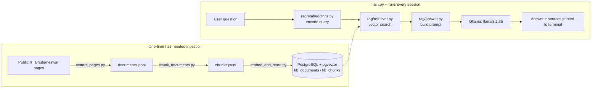

# IIT Bhubaneswar RAG Assistant

A small, standalone, terminal-based RAG (Retrieval-Augmented Generation) chatbot
that answers questions about IIT Bhubaneswar using only public documents you
ingest yourself. No frontend, no backend server, no deployment -- it runs with
`python main.py` in a VS Code terminal.

This project exists to demonstrate a RAG pipeline end to end (ingestion,
chunking, embeddings, vector search, grounded generation) in a small enough
codebase to explain line-by-line in an interview. It was built as a
standalone companion to a larger project, [`campus-rag-assistant`](https://github.com/sandeep-jay/campus-rag-assistant),
reusing its local retrieval design (see "Relationship to campus-rag-assistant" below).

## Features

- Terminal chat loop: ask a question, get an answer + sources, repeat
- Retrieval-grounded answers: the LLM only sees retrieved document chunks,
  never the open internet or its own pretrained knowledge, for *college facts*
- Explicit refusal when the answer isn't in the knowledge base, instead of
  guessing
- Fully local: embeddings run on your machine (sentence-transformers),
  generation runs on your machine (Ollama), vectors live in your own
  Postgres instance

## Technology stack

| Layer | Choice |
|---|---|
| Language | Python 3.11+ |
| Embeddings | `sentence-transformers/all-MiniLM-L6-v2` (384-dim) |
| Vector store | PostgreSQL + [pgvector](https://github.com/pgvector/pgvector) |
| LLM | [Ollama](https://ollama.com/) running `llama3.2:3b` locally |
| Scraping/parsing | `requests` + `BeautifulSoup4` |

## Architecture



**The RAG pipeline, in words:** a question is embedded with the same model
used for documents, pgvector finds the nearest chunks by cosine distance,
those chunks are stitched into a prompt that instructs the model to answer
*only* from that context, and Ollama generates the final response. If
retrieval finds nothing relevant, the user gets an honest "I couldn't find
this" instead of a guess.

## Project structure

```
iitbbs-rag-assistant/
├── README.md
├── requirements.txt
├── .gitignore
├── .env.example
├── main.py                        # terminal chat loop
├── rag/
│   ├── __init__.py
│   ├── config.py                  # loads .env into one Settings object
│   ├── embeddings.py              # sentence-transformers wrapper (singleton)
│   ├── retriever.py                # pgvector similarity search
│   └── answer.py                  # Ollama prompt + call
├── scripts/
│   ├── extract_pages.py           # step 1: scrape public pages -> documents.jsonl
│   ├── chunk_documents.py         # step 2: documents.jsonl -> chunks.jsonl
│   ├── embed_and_store.py         # step 3: chunks.jsonl -> embeddings in Postgres
│   ├── test_vector_search.py      # smoke test: retrieval only, no Ollama
│   └── test_local_retriever.py    # smoke test: retrieval + generation together
└── data/
    ├── raw/
    │   └── seed_urls.txt          # list of public URLs to scrape
    └── processed/
        ├── documents.jsonl        # SAMPLE placeholder (see note below)
        ├── chunks.jsonl           # generated from the sample documents
        └── faculty.json           # SAMPLE placeholder, unused by any script
```

## Prerequisites

- Python 3.11+
- [PostgreSQL](https://www.postgresql.org/) 13+ with the
  [pgvector](https://github.com/pgvector/pgvector) extension installed
  (easiest: `docker run -d -p 5432:5432 -e POSTGRES_USER=chatbot -e POSTGRES_PASSWORD=chatbot -e POSTGRES_DB=chatbot_dev pgvector/pgvector:pg14`)
- [Ollama](https://ollama.com/download) installed, with the model pulled:
  ```
  ollama pull llama3.2:3b
  ```

## Setup (VS Code, PowerShell)

```powershell
# 1. Create and activate a virtual environment
python -m venv venv
.\venv\Scripts\Activate.ps1

# 2. Install dependencies
pip install -r requirements.txt

# 3. Configure environment
Copy-Item .env.example .env
# edit .env if your DATABASE_URL, OLLAMA_MODEL, etc. differ from the defaults

# 4. Make sure PostgreSQL has the pgvector extension available
#    (the ingestion script will run `CREATE EXTENSION IF NOT EXISTS vector;`
#    itself, but your DB user needs permission to do that once)

# 5. Make sure Ollama is running
ollama serve
# (in a separate terminal, if it isn't already running as a service)
```

## Ingestion (build the knowledge base)

Run these three scripts **in order**. Each one reads the previous step's
output file, so re-running an earlier step invalidates later ones until
you re-run those too.

```powershell
# Step 1: add real public URLs to data/raw/seed_urls.txt first, then:
python scripts\extract_pages.py

# Step 2: split into overlapping chunks
python scripts\chunk_documents.py

# Step 3: embed and store in pgvector
python scripts\embed_and_store.py
```

This repo ships with a small set of **sample placeholder documents**
already run through steps 2 (`data/processed/chunks.jsonl` exists) so you
can test the pipeline's mechanics immediately -- see "Known limitations"
for why these are not real IIT Bhubaneswar data and what to do about it.

Re-running `embed_and_store.py` is safe: it upserts by ID rather than
duplicating rows, so adding new documents later does not require
rebuilding the whole knowledge base from scratch.

## Running the chatbot

```powershell
python main.py
```

Type a question, press Enter. Type `exit` or `quit` to leave.

## Testing

```powershell
# Retrieval only (no Ollama needed) -- confirms embeddings + pgvector search work
python scripts\test_vector_search.py "What is the attendance policy?"

# Full pipeline: retrieval + Ollama generation, using three example questions
python scripts\test_local_retriever.py
```

### Example questions to try

- "What is the minimum attendance requirement?" *(answerable from the sample data)*
- "How do I submit semester feedback?" *(answerable from the sample data)*
- "What is the president of IIT Bhubaneswar's personal phone number?" *(should be refused, not fabricated)*

## Relationship to campus-rag-assistant

This project's `rag/retriever.py` is designed to query the same
`kb_documents` / `kb_chunks` table shape used by the
`LocalPgVectorRetriever` provider in the original `campus-rag-assistant`
project, so the two can share a populated database if you want. This
standalone project does not import any code from that repo directly --
the main `campus-rag-assistant` repository (as published on GitHub) does
not actually contain a local/Ollama ingestion pipeline to import from;
it's a larger multi-cloud (AWS Bedrock / Azure / GCP) platform. This
project was written fresh, matching the local provider's table schema for
compatibility.

## Known limitations

- **Sample data is placeholder, not real IIT Bhubaneswar content.** The
  `documents.jsonl` / `chunks.jsonl` shipped in this repo are clearly
  labeled `[SAMPLE DATA]` and contain illustrative, made-up policy text --
  not information scraped from `iitbbs.ac.in`. Run `scripts/extract_pages.py`
  against real public URLs (add them to `data/raw/seed_urls.txt`) to build
  a real knowledge base before relying on this for actual answers.
- **Re-embedding is not incremental.** `embed_and_store.py` recomputes
  embeddings for every chunk it's given each time it runs. For a small
  corpus this is fast; for a large one, you'd want to track which
  chunk_ids changed and only re-embed those.
- **No reranking or hybrid search.** Retrieval is pure vector cosine
  similarity via pgvector's `<=>` operator -- no keyword/BM25 fusion or
  cross-encoder reranking, which a production system would likely add.
- **No chat history / multi-turn memory.** Each question is answered
  independently; the model doesn't see earlier turns in the conversation.
- **Execution of the live pipeline (real DB + real Ollama + real scrape)
  has not been run end-to-end in the environment that generated this
  code.** The code has been syntax-checked (`python -m py_compile` passes
  on every file) and the chunking script has actually been run against
  the sample documents to produce `chunks.jsonl`, but a live run against
  Postgres/pgvector and a running Ollama instance requires your local
  machine. Run `scripts/test_vector_search.py` and
  `scripts/test_local_retriever.py` yourself and treat their printed
  output as the real test results -- don't take this README's word for it.

## Attribution

Content ingested via `scripts/extract_pages.py` originates from public
pages on the IIT Bhubaneswar website (`iitbbs.ac.in`) that you choose to
include in `data/raw/seed_urls.txt`. This project does not scrape,
authenticate against, or otherwise access the institute's ERP system --
only publicly published pages.
